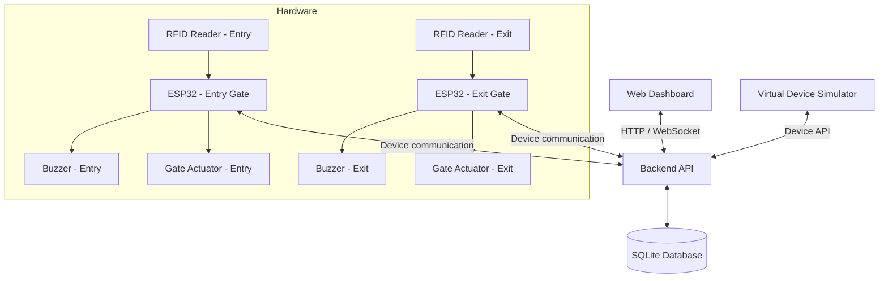

# Smart Parking System

<p align="center">
  <strong>RFID-Based IoT Gate Automation & Parking Monitoring</strong>
</p>

<p align="center">
  Sistem gerbang parkir berbasis ESP32 untuk mengelola akses kendaraan melalui kartu RFID, memantau dua gerbang parkir, dan mencatat aktivitas kendaraan ke database SQLite.
</p>

---

## Overview

**Smart Parking System** merupakan proyek Internet of Things (IoT) yang dirancang untuk membantu proses pengelolaan akses kendaraan pada area parkir. Sistem menggunakan ESP32 sebagai pengendali perangkat, modul RFID sebagai autentikasi pengguna, dan aktuator untuk menggerakkan palang gerbang.

Sistem dirancang dengan dua jalur terpisah, yaitu **gerbang masuk (entry gate)** dan **gerbang keluar (exit gate)**. Aktivitas pemindaian kartu, waktu transaksi, serta status gerbang akan dikirimkan ke server dan disimpan ke database SQLite agar dapat dipantau melalui dashboard web.

Proyek ini juga menyediakan rancangan kendali manual melalui dashboard untuk kebutuhan operasional atau keadaan darurat. Perintah dari dashboard diteruskan ke perangkat dan status gerbang diperbarui berdasarkan konfirmasi perangkat.

> **Project status:** In development. Repository ini sedang disiapkan untuk pengembangan bertahap, dimulai dari dokumentasi, simulasi perangkat, backend, database, dashboard, kemudian integrasi hardware.

## Objectives

- Membangun prototipe sistem gerbang parkir berbasis ESP32.
- Menggunakan RFID untuk autentikasi akses kendaraan.
- Memisahkan proses masuk dan keluar melalui dua gerbang.
- Mencatat tanggal dan waktu transaksi secara terperinci.
- Menyediakan monitoring status gerbang melalui dashboard web.
- Menyimpan data kartu dan riwayat parkir menggunakan SQLite.
- Menyediakan kendali gerbang jarak jauh dengan mekanisme konfirmasi perangkat.
- Mengembangkan simulator agar sistem dapat diuji sebelum seluruh perangkat fisik tersedia.

## Planned Features

| Feature | Description | Status |
|---|---|---|
| RFID authentication | Validasi UID kartu RFID | Planned |
| Entry gate | Kontrol palang kendaraan masuk | Planned |
| Exit gate | Kontrol palang kendaraan keluar | Planned |
| Parking activity log | Pencatatan waktu dan aktivitas kendaraan | Planned |
| Live gate monitoring | Monitoring status dua gerbang | Planned |
| Parking statistics | Ringkasan kendaraan masuk, keluar, dan di dalam area | Planned |
| Emergency control | Perintah buka/tutup gerbang dari dashboard | Planned |
| SQLite database | Penyimpanan data secara lokal | Planned |
| Virtual device simulator | Simulasi ESP32 dan transaksi RFID | Planned |

Status fitur akan diperbarui sesuai hasil implementasi dan pengujian.

## System Architecture

Rancangan arsitektur sistem:



The virtual simulator and physical ESP32 devices are intended to use the same backend communication interface. This allows the dashboard and database to be developed and tested before the hardware integration is complete.

## Proposed Technology Stack

| Layer | Technology | Purpose |
|---|---|---|
| Microcontroller | ESP32 | Device control and communication |
| RFID | RFID reader module (planned) | Card identification |
| Actuator | Servo / compatible gate actuator | Gate movement |
| Notification | Buzzer | Audio feedback |
| Frontend | React + Tailwind CSS (proposed) | Web dashboard |
| Backend | Node.js + Express (proposed) | API and application logic |
| Database | SQLite | Local structured data storage |
| Communication | REST API + WebSocket (proposed) | Device and dashboard communication |
| Simulator | Software-based virtual device | Hardware-independent testing |

The software stack is a proposed implementation and may be adjusted during development.

## Hardware Components

The planned hardware components are:

- ESP32 development board.
- RFID reader module and RFID cards.
- Gate actuator.
- Buzzer.
- Power source / battery.
- Supporting wiring and electronic components.

**Design note:** This project does not currently use an HC-SR04 ultrasonic sensor. Vehicle events are initiated by RFID authentication. Therefore, the prototype does not independently detect whether a vehicle has physically passed the gate unless an additional detection mechanism is introduced.

## Data Management

The database is planned to manage the following information:

| Data entity | Purpose |
|---|---|
| RFID cards | Registered card UID and card ownership/reference |
| Parking records | Vehicle entry and exit transactions |
| Gate status | Latest reported status of each gate |
| Gate commands | Manual commands and their execution status |

Each parking event is intended to include a date-time value with second-level precision and a gate identifier. The application should use a consistent timezone, with **Asia/Jakarta (UTC+07:00)** as the intended local timezone.

## Dashboard Modules

The planned dashboard will contain:

1. **Overview** — total vehicles entering, exiting, and currently inside the parking area.
2. **Gate Monitoring** — separate status panels for the entry and exit gates.
3. **Parking History** — searchable transaction history with date and time.
4. **RFID Management** — registered card management.
5. **Emergency Control** — authorized manual open/close commands for each gate.
6. **Device Monitoring** — device connectivity and last reported status.

## Important System Considerations

- A valid RFID scan is an access event; it is not proof that a vehicle has physically crossed the gate.
- The number of vehicles inside the area is calculated from recorded entry and exit transactions. The application must prevent invalid or duplicate transactions.
- A dashboard command must be acknowledged by the ESP32 before the application reports that the physical gate has changed state.
- A communication failure must not be presented as a confirmed gate state. The dashboard should distinguish the last reported state from an unknown or disconnected device.
- Emergency control should be restricted to authorized users and recorded in an audit log.
- A software emergency command is not a substitute for physical safety mechanisms or emergency-stop hardware.

## Repository Structure

The repository will be organized progressively as the implementation develops.

```text
Smart-Parking-System-Project/
├── docs/
│   ├── ARCHITECTURE.md
│   ├── DATABASE.md
│   └── ROADMAP.md
├── firmware/
│   ├── entry-gate/
│   └── exit-gate/
├── backend/
├── frontend/
├── simulator/
├── assets/
├── .gitignore
└── README.md
```

Directories for firmware, backend, frontend, simulator, and assets will be added when their source files are introduced.

## Development Roadmap

- [x] Create the project repository.
- [x] Prepare initial project documentation.
- [ ] Finalize hardware and software requirements.
- [ ] Design the SQLite database schema.
- [ ] Implement backend API.
- [ ] Build the virtual device simulator.
- [ ] Develop the web dashboard.
- [ ] Integrate dashboard, backend, and database.
- [ ] Implement ESP32 firmware for the entry gate.
- [ ] Implement ESP32 firmware for the exit gate.
- [ ] Integrate RFID readers and gate actuators.
- [ ] Test access validation and transaction consistency.
- [ ] Test emergency control and communication failure handling.
- [ ] Prepare final documentation and demonstration.

## Getting Started

The application is not yet ready to run. Installation and execution instructions will be added after the frontend, backend, and simulator have been implemented.

## Documentation

- [System Architecture](docs/ARCHITECTURE.md)
- [Database Design](docs/DATABASE.md)
- [Development Roadmap](docs/ROADMAP.md)

## Project Scope

This repository is developed as an academic IoT project. The initial scope focuses on RFID-based access control, two-gate monitoring, transaction logging, and web-based management. It is a prototype and should not be treated as a production-certified parking barrier or a safety-critical access-control system.

## Contributors

Add project team members and their respective roles here as the team structure is finalized.

## License

No open-source license has been selected yet. All rights are reserved by the project authors unless a license is added to this repository.
