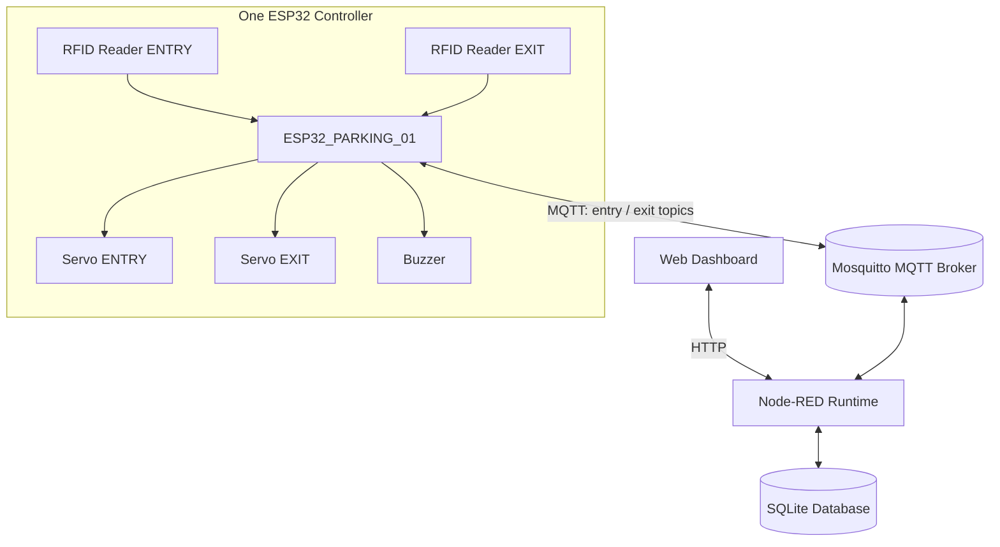

# Smart Parking System

<p align="center">
  <strong>RFID-Based IoT Gate Automation & Parking Monitoring</strong>
</p>

<p align="center">
  Sistem gerbang parkir berbasis satu ESP32 untuk mengelola akses kendaraan melalui dua RFID reader, mengendalikan dua palang, dan mencatat aktivitas kendaraan ke database SQLite.
</p>

---

## Overview

**Smart Parking System** merupakan proyek Internet of Things (IoT) untuk membantu pengelolaan akses kendaraan pada area parkir. Sistem menggunakan **satu board ESP32** sebagai pengendali bersama untuk dua jalur: gerbang masuk (entry) dan gerbang keluar (exit).

Satu ESP32 terhubung ke dua RFID reader dan dua servo. Perangkat menentukan jalur berdasarkan reader yang menerima kartu, lalu menggunakan identitas `gate_id` (`entry` atau `exit`) saat berkomunikasi dengan Node-RED melalui MQTT.

Node-RED memproses validasi dan transaksi, sedangkan SQLite menyimpan data kartu, sesi parkir, perintah, serta riwayat. Dashboard web menampilkan statistik dan menyediakan kendali manual untuk masing-masing palang.

> **Project status:** In development. Flow Node-RED, skema database, dashboard, dan starter firmware tersedia di branch ini. Kompilasi firmware, deployment runtime, wiring, dan pengujian perangkat fisik masih harus dilakukan.

## Objectives

- Membangun prototipe sistem parkir berbasis satu ESP32.
- Menggunakan dua RFID reader untuk jalur masuk dan keluar.
- Mengendalikan dua servo palang secara terpisah dari satu board.
- Mencatat tanggal dan waktu transaksi.
- Menyediakan monitoring kedua jalur melalui dashboard.
- Menyimpan data kartu dan riwayat parkir menggunakan SQLite.
- Menyediakan kendali manual dengan konfirmasi perangkat.

## System Architecture



## Proposed Technology Stack

| Layer | Technology | Purpose |
|---|---|---|
| Microcontroller | 1 × ESP32 | Shared controller for both lanes |
| RFID | 2 × RC522 | Entry and exit card identification |
| Actuator | 2 × servo | Separate entry and exit barriers |
| Notification | Buzzer | Audio feedback |
| Flow runtime | Node-RED | API, transaction logic, device integration |
| Dashboard | Node-RED HTTP template | Monitoring and operator controls |
| Database | SQLite | Cards, sessions, status, and command records |
| Communication | Mosquitto MQTT | Device events, commands, and status |

## Hardware Components

- 1 ESP32 development board.
- 2 RFID RC522 modules and RFID cards.
- 2 servo motors (one per gate).
- 1 buzzer.
- Suitable regulated power supply for the servos.
- Supporting wiring and mechanical gate components.

Both RC522 readers share the ESP32 SPI bus with separate chip-select pins. Each servo has a separate GPIO signal. Servo power must be supplied appropriately; do not power two servos from the ESP32 3.3 V output.

**Design note:** The project does not currently use an HC-SR04 ultrasonic sensor. RFID scans initiate access transactions but do not prove that a vehicle physically passed the gate. No anti-crush or obstruction-detection function is claimed without additional sensors.

## Dashboard Modules

1. **Overview** — total vehicles entering, exiting, and currently inside.
2. **Gate Monitoring** — separate status panels for entry and exit.
3. **Parking History** — transaction history with date and time.
4. **RFID Management** — registered card management.
5. **Emergency Control** — authorized manual commands for either gate.
6. **Device Monitoring** — one ESP32 controller's connectivity and last reported status, with separate gate states.

## Important System Considerations

- One controller handles both lanes; MQTT topics remain separate using `entry` and `exit`.
- A valid RFID scan is an access event, not proof of physical vehicle passage.
- A command acknowledgement means firmware issued the servo command. Without a position sensor, the physical gate position is not independently verified.
- Network failure must not be displayed as successful gate operation.
- Dashboard controls require authentication and authorization before deployment.
- Physical safety mechanisms are separate from software controls.

## Repository Structure

```text
Smart-Parking-System-Project/
├── docs/
│   ├── ARCHITECTURE.md
│   ├── DEVICE_PROTOCOL.md
│   ├── DATABASE.md
│   ├── NODE_RED.md
│   └── ROADMAP.md
├── firmware/
│   ├── smart-parking/
│   │   └── smart-parking.ino
│   └── README.md
├── node-red/
│   ├── flows/
│   ├── dashboard/
│   └── sql/
└── README.md
```

## Getting Started

See [Node-RED setup](node-red/README.md), [firmware setup](firmware/README.md), [system architecture](docs/ARCHITECTURE.md), and [MQTT protocol](docs/DEVICE_PROTOCOL.md).

The firmware is a starter sketch and still needs compilation and hardware testing with both readers and both servos.

## Project Scope

This repository is developed as an academic IoT prototype. It focuses on RFID-based access, two-gate monitoring, transaction logging, and web-based management. It is not a production-certified parking barrier or safety-critical access-control system.
