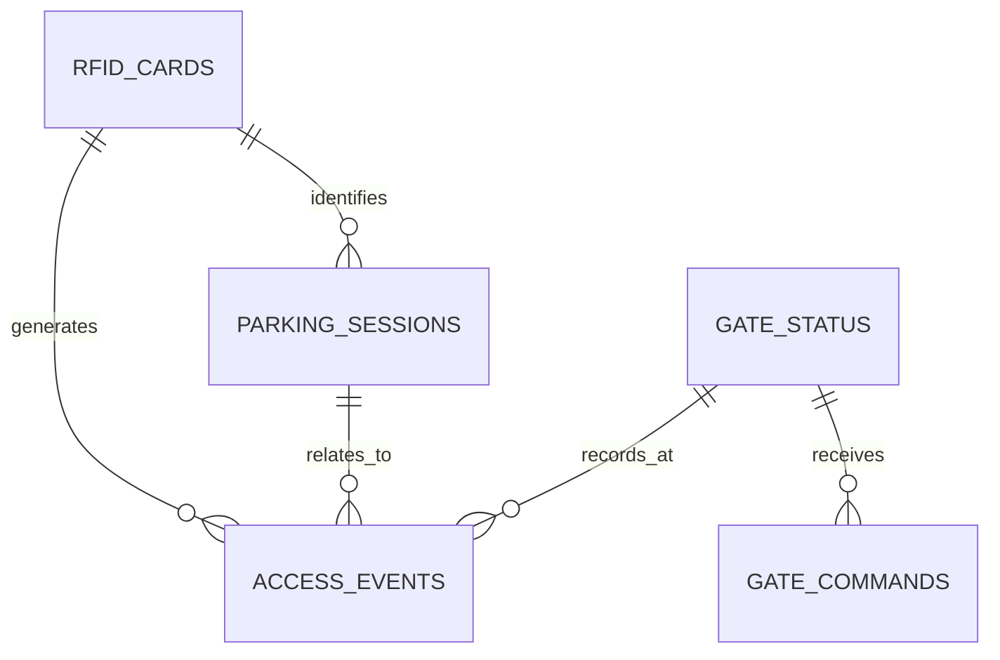

# Database Design

## 1. Purpose

This document defines an initial relational data model for the Smart Parking System. It is a proposed schema and should be validated against the final application workflow before production use.

SQLite is selected for the prototype because it is lightweight and can store structured application data in a local database file.

## 2. Main Entities

| Table | Purpose |
|---|---|
| `rfid_cards` | Registered RFID UIDs and card metadata |
| `parking_sessions` | A vehicle's active or completed parking session |
| `access_events` | Accepted and rejected RFID access attempts |
| `gate_status` | Latest reported state of each gate |
| `gate_commands` | Manual commands and device acknowledgements |
| `audit_logs` | Administrative and security-relevant actions |

## 3. Relationship Overview



## 4. Initial SQL Schema

```sql
PRAGMA foreign_keys = ON;

CREATE TABLE IF NOT EXISTS rfid_cards (
    id INTEGER PRIMARY KEY AUTOINCREMENT,
    uid TEXT NOT NULL UNIQUE,
    owner_label TEXT,
    is_active INTEGER NOT NULL DEFAULT 1
        CHECK (is_active IN (0, 1)),
    created_at TEXT NOT NULL DEFAULT CURRENT_TIMESTAMP
);

CREATE TABLE IF NOT EXISTS gate_status (
    gate_id TEXT PRIMARY KEY,
    gate_type TEXT NOT NULL
        CHECK (gate_type IN ('ENTRY', 'EXIT')),
    device_id TEXT NOT NULL UNIQUE,
    reported_state TEXT NOT NULL DEFAULT 'UNKNOWN'
        CHECK (reported_state IN ('OPEN', 'CLOSED', 'MOVING', 'UNKNOWN', 'OFFLINE')),
    last_seen_at TEXT,
    updated_at TEXT NOT NULL DEFAULT CURRENT_TIMESTAMP
);

CREATE TABLE IF NOT EXISTS parking_sessions (
    id INTEGER PRIMARY KEY AUTOINCREMENT,
    card_id INTEGER NOT NULL,
    entry_gate_id TEXT NOT NULL,
    entry_time TEXT NOT NULL,
    exit_gate_id TEXT,
    exit_time TEXT,
    session_status TEXT NOT NULL DEFAULT 'ACTIVE'
        CHECK (session_status IN ('ACTIVE', 'COMPLETED', 'CANCELLED')),
    FOREIGN KEY (card_id) REFERENCES rfid_cards(id),
    FOREIGN KEY (entry_gate_id) REFERENCES gate_status(gate_id),
    FOREIGN KEY (exit_gate_id) REFERENCES gate_status(gate_id)
);

CREATE UNIQUE INDEX IF NOT EXISTS one_active_session_per_card
ON parking_sessions(card_id)
WHERE session_status = 'ACTIVE';

CREATE TABLE IF NOT EXISTS access_events (
    id INTEGER PRIMARY KEY AUTOINCREMENT,
    event_uid TEXT NOT NULL UNIQUE,
    card_id INTEGER,
    gate_id TEXT NOT NULL,
    access_result TEXT NOT NULL
        CHECK (access_result IN ('GRANTED', 'DENIED')),
    event_time TEXT NOT NULL,
    reason TEXT,
    session_id INTEGER,
    FOREIGN KEY (card_id) REFERENCES rfid_cards(id),
    FOREIGN KEY (gate_id) REFERENCES gate_status(gate_id),
    FOREIGN KEY (session_id) REFERENCES parking_sessions(id)
);

CREATE TABLE IF NOT EXISTS gate_commands (
    id INTEGER PRIMARY KEY AUTOINCREMENT,
    command_uid TEXT NOT NULL UNIQUE,
    gate_id TEXT NOT NULL,
    command TEXT NOT NULL
        CHECK (command IN ('OPEN', 'CLOSE')),
    command_status TEXT NOT NULL DEFAULT 'PENDING'
        CHECK (command_status IN ('PENDING', 'ACKNOWLEDGED', 'FAILED', 'TIMEOUT')),
    requested_at TEXT NOT NULL DEFAULT CURRENT_TIMESTAMP,
    acknowledged_at TEXT,
    requested_by TEXT,
    result_message TEXT,
    FOREIGN KEY (gate_id) REFERENCES gate_status(gate_id)
);

CREATE TABLE IF NOT EXISTS audit_logs (
    id INTEGER PRIMARY KEY AUTOINCREMENT,
    actor TEXT NOT NULL,
    action TEXT NOT NULL,
    details TEXT,
    created_at TEXT NOT NULL DEFAULT CURRENT_TIMESTAMP
);
```

## 5. Data Rules

1. An RFID UID must be unique.
2. Only active cards may be granted access.
3. A card should not create a second active parking session while it already has one.
4. An exit event should complete an existing active session; an exit without a matching active session should be rejected or flagged for operator review.
5. Every device event should have a unique `event_uid` so retries do not create duplicate records.
6. A gate command remains pending until the device acknowledges it or the backend marks it failed or timed out.
7. Store timestamps in ISO 8601 format with an explicit timezone, preferably UTC in storage. Convert to Asia/Jakarta for display.

## 6. Example Queries

### Count active parking sessions

```sql
SELECT COUNT(*) AS vehicles_inside
FROM parking_sessions
WHERE session_status = 'ACTIVE';
```

### Daily entry and exit totals

```sql
SELECT
    DATE(event_time) AS event_date,
    SUM(CASE WHEN access_result = 'GRANTED' AND gate_id = 'ENTRY_GATE' THEN 1 ELSE 0 END) AS entries,
    SUM(CASE WHEN access_result = 'GRANTED' AND gate_id = 'EXIT_GATE' THEN 1 ELSE 0 END) AS exits
FROM access_events
GROUP BY DATE(event_time)
ORDER BY event_date DESC;
```

The daily totals above are a simple event count. For operational reporting, derive totals from successfully created or completed parking sessions so duplicate scans and rejected attempts are not counted as vehicle movements.

## 7. Notes

This schema is an initial design, not a migration already applied to a running application. The implementation should add indexes based on actual query patterns, validate all input on the backend, and use database transactions when creating or completing parking sessions.
